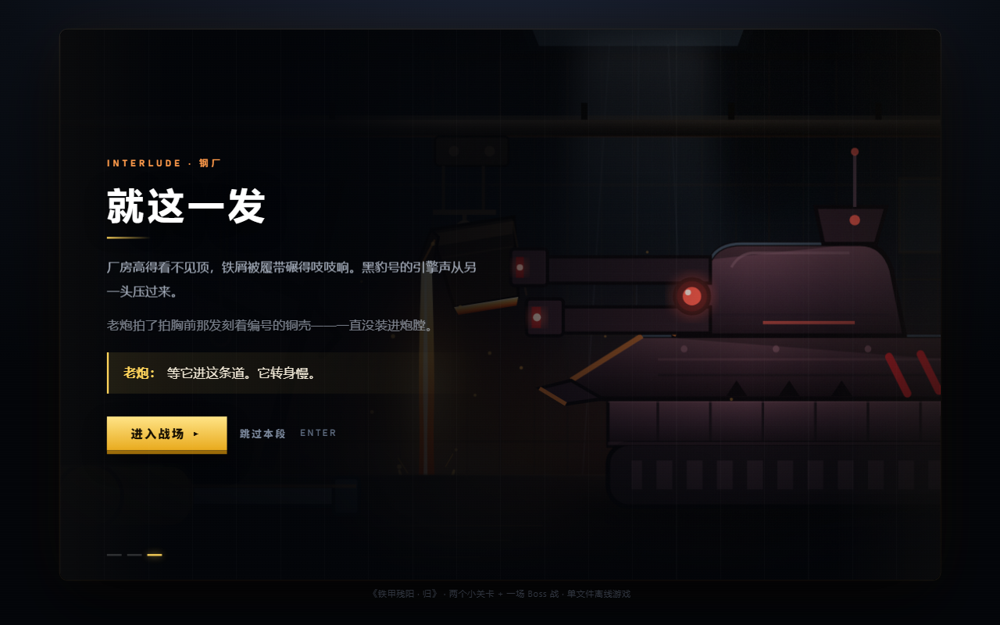
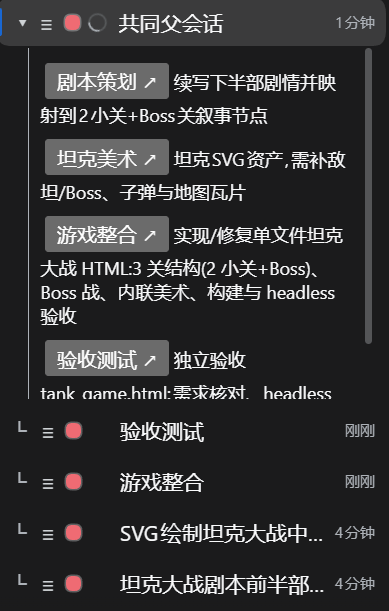

# dsh-session-tree

你有没有想过，把一个会话里已经做好的成果，直接用到更大的项目里？如果几个项目都需要同一份成果，能不能沿用之前的会话，省去反复交代需求、来回搬运素材的麻烦？

用 **dsh-session-tree**，你可以单独开一个会话做美术，再开两个会话分别做游戏和短视频。把美术会话分别挂载到这两个项目下，它们就能沿用现有素材和之前约定的画风，在各自的美术子会话里继续调整。原来的美术会话也会保留，下个项目还可以接着用。

[Windows 安装](#windows) · [Linux 安装](docs/install-linux.md) · [macOS 安装](docs/install-macos.md) · [发行版本](https://github.com/plasticmemories-0823/dsh-session-tree/releases)

## 实际案例 · 《铁甲残阳·归》

把已有剧本和美术会话组织成一棵会话树，交付了包含两小关和一场 Boss 战的单文件离线游戏。插件从原会话恢复美术回执，将 Boss 场景图交给整合会话。整合完成后，验收会话自动启动，根会话在收到结果后更新了全部 **8 项任务**。最终 HTML 通过 **64 项全量验收**和 **25 项专项验收**。

**[下载游戏 HTML](https://github.com/plasticmemories-0823/dsh-session-tree/releases/download/v0.7.0/tank_game.html)**。下载后用浏览器打开即可离线游玩。



[查看会话树交付记录与任务清单](docs/images/completed-project.png)

## 安装与卸载

### Windows

已验证环境为 **Windows 桌面版 DeepSeek Harness `0.2.2-rc.3`**。插件依赖该版本的工作区客户端，安装器会检查版本。请先从 [DeepSeek Harness 官方项目](https://github.com/deepseek-ai/deepseek-harness) 安装对应版本并启动一次。使用安装包时无需单独安装 Node.js。

1. 下载并解压 Windows 安装包，双击 `DSH Session Tree Manager.exe`。程序会显示 DSH 安装位置、插件当前版本和安装包版本。需要时点「选择程序…」定位 `DeepSeek Harness.exe`。[下载 Windows 安装包](https://github.com/plasticmemories-0823/dsh-session-tree/releases/download/v0.8.1/dsh-session-tree-windows.zip)
2. 从 DSH 应用菜单或系统托盘退出 DSH。管理器检测到退出后，点击「安装插件」或「安装此版本」。安装完成后点击「打开 DSH」。
3. 要卸载时，重新打开同一个管理器，退出 DSH 后点击「卸载插件」并确认。原始会话和会话树数据仍保存在本机。操作失败时可展开「操作日志」。

也可以下载 [v0.8.1 插件包](https://github.com/plasticmemories-0823/dsh-session-tree/releases/download/v0.8.1/dsh-session-tree-0.8.1.tgz) 手动安装。请在包所在目录运行以下命令，并将 `$dsh` 改为实际安装路径。安装后保留 `.tgz`，便于 DSH 的包管理器继续解析该依赖。

```powershell
$dsh = 'C:\path\to\DeepSeek Harness\resources\runtime\cli\bin\dsh.cmd'
$tgz = (Resolve-Path '.\dsh-session-tree-0.8.1.tgz').Path.Replace('\', '/')
& $dsh plugin --profile desktop add "file:$tgz"
```

命令行卸载使用 `& $dsh plugin --profile desktop remove dsh-session-tree`。重启后恢复 DSH 原生侧栏。

### Linux 和 macOS

在浏览器中使用本地图形管理器安装和卸载。两个版本均需 Node.js 24.9+ 和 DSH `0.2.2-rc.3`。

- Linux 使用 DSH Web。[Linux 下载与安装教程](docs/install-linux.md)
- macOS 使用 DSH 桌面版。[macOS 下载与安装教程](docs/install-macos.md)

已有 `dsh` 命令的用户也可以直接安装 Release 中的预构建插件包。Linux 使用 `web` 配置，macOS 和 Windows 使用桌面版自带的 CLI，并将命令中的 `web` 改为 `desktop`。安装后重启对应的 DSH 进程。

```sh
dsh plugin --profile web add https://github.com/plasticmemories-0823/dsh-session-tree/releases/download/v0.8.1/dsh-session-tree-0.8.1.tgz
```

## 快速开始

### 挂载到已有会话

1. 在侧栏找到需要复用的会话。按住 **Ctrl**（macOS 用 **⌘**）并拖到已有的目标会话行上。普通拖动用于调整顺序。
2. 看到「挂载到 XXX 下」后松开鼠标。有旧项目上下文或未选中的子会话时，先阅读提示，再点「确认挂载」。
3. 展开目标会话即可打开新挂载的子会话。挂载会使用来源会话的副本，原会话仍可供其他项目复用。副本保留已有历史，两个项目中的后续对话各自独立。

### 从多个会话创建共同父会话

1. 在同一个工作区，按住 **Ctrl**（macOS 使用 **⌘**）选择两个已有会话，然后右键选择「创建共同父会话」。插件为每个来源创建副本并挂载到新的根会话下。来源会话仍可独立使用。
2. 在根会话发送首条任务说明。明确交付要求、执行分工和任务依赖。可以使用下面这条示例。

   > 请基于已有剧本和 SVG 素材交付一个离线 HTML 游戏。先由美术会话制作 Boss 场景图，再由整合会话将图内联到剧情页，最后由验收会话验证实际显示和离线运行。请核验最终文件并汇报。

3. 展开根会话，点击行首的 **≡** 查看分工、任务和回执。打开任一子会话，即可查看它收到的执行请求和回复。


## 侧栏操作

| 操作 | 行为 |
| --- | --- |
| 单击会话 | 打开会话并清除多选。 |
| Ctrl / ⌘ + 单击 | 切换单个会话的选中状态。 |
| Shift + 单击父会话 | 切换整个分支的选中状态，包含折叠的后代会话。 |
| 普通拖动 | 按 DSH 原生规则调整会话顺序。 |
| Ctrl / ⌘ + 拖到目标会话 | 出现「挂载到 XXX 下」时松开鼠标。来源会话以副本挂载，原会话保留。选中的后代会话挂载到最近的已选祖先会话副本下。 |
| 右键 → 创建子会话 | 创建子会话并同步与当前任务相关的背景信息。 |
| 多选 → 创建共同父会话 | 创建根会话并挂载来源会话的副本。发送首条任务说明后同步分工和任务背景。 |
| 多选 → 合并到新会话 | 创建一个独立会话，整合所选会话的摘要并保留来源入口。 |
| 点击颜色圆点 | 设置单个会话或整棵树的颜色。后代会话默认继承根会话颜色，解除挂载后保留颜色标记。 |
| 右键 → 解除挂载 | 移除父子关系并保留会话记录。 |
| 归档 / 移到回收站 | 归档会解除相关挂载。Windows 另有「移到回收站」，可移除所选会话的本地记录并保留已有副本和工作区文件。 |



## 任务调度与回执

**根会话**是会话树中没有父会话的节点。根会话拥有子会话时，承担任务拆分、委派、只读核验和结果汇报。**父会话**和**子会话**描述相邻的两层关系。中间层会话既是上一级的子会话，也是下一层的父会话。它可以执行任务，也可以委派给自己的直属子会话。

| 工具 | 用途 |
| --- | --- |
| `session_tree_list` | 查询直属子会话及其职责。 |
| `session_tree_create` | 创建可在侧栏打开的直属子会话。 |
| `session_tree_send` | 委派任务。通过 `after` 指定同一父会话下的前置任务 ID，前置任务完成后，插件将回执和产物路径附到下游请求。 |
| `session_tree_result` | 查询执行状态和回执，支持分页读取长回复。 |
| `session_tree_read_source` | 查看合并会话的来源及对应历史。 |

子会话结束一轮执行时，插件先保存执行状态、原始回复和明确列出的产物路径，再异步生成摘要。摘要超限时会重新压缩，分段进度会持久化。摘要失败时，原始回复仍可用于查询和产物交接。

父会话在运行时可以读取新回执。父会话已进入空闲状态时，插件可在该批委派任务结算后自动启动一轮后续处理，用于核验产物、更新任务清单和汇报结果。用户直接在子会话中发起的对话只生成回执，由父会话在下一轮推理时读取。父会话主动停止或被归档时，自动续跑暂停。任务显示「待核对」时，可打开对应子会话检查执行记录。

会话层级、配色、任务和回执保存在 `$DSH_HOME/session-tree/state.json`，默认位于当前用户的 `.dsh` 目录。任务执行、摘要和自动续跑使用 DSH 配置的模型，可能产生模型用量。

## 从源码构建

使用 Node.js 24 或更新版本。

```powershell
npm ci --legacy-peer-deps
npm run check
npm test
npm pack
powershell -NoProfile -File scripts/package-windows.ps1
```

Windows 打包脚本在 `dist/` 生成安装 ZIP、独立插件包及 SHA-256 校验文件。桌面回归测试运行真实 DSH Host 和 Web 客户端，使用本地模拟模型验证任务委派、原文回执回退、依赖调度和恢复流程。[开发与测试说明](docs/testing.md)

Linux 和 macOS 安装包使用 `npm run package:unix` 生成，产物为 `dist/` 下的两个 `.tar.gz` 文件和 `SHA256SUMS-unix.txt`。

本项目是 DeepSeek Harness 的独立社区插件，采用 [MIT 许可证](LICENSE)。打包时使用的上游工作区客户端保留 [DeepSeek 版权及许可证声明](LICENSE-DSH.txt)。
