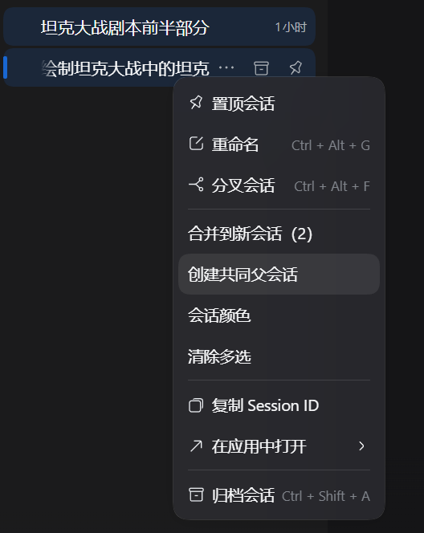
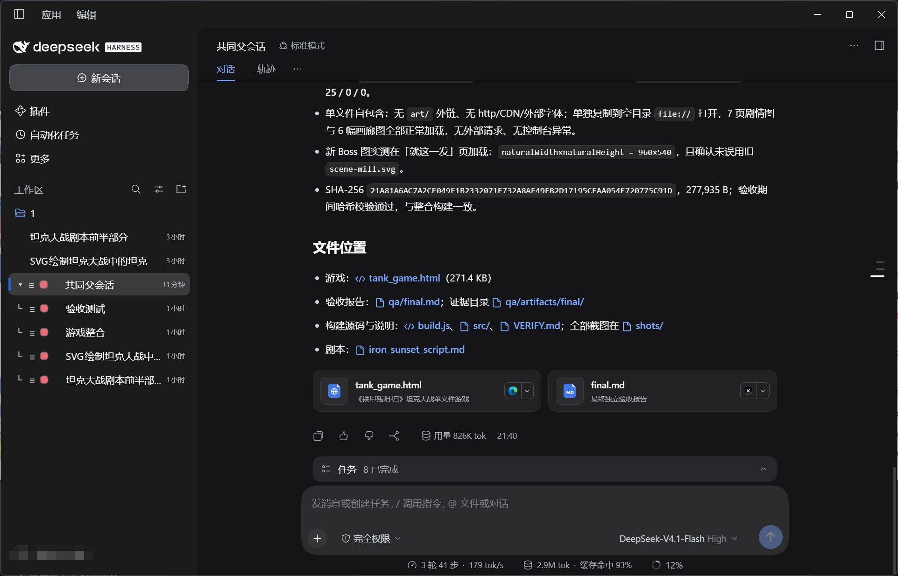

# dsh-session-tree

在 DeepSeek Harness 原生侧栏里，把现有会话组织成一棵可派活、可交接产物、可继续收尾的会话树。每个子节点都是一个可打开、能单独继续聊天的 DSH 会话。

[下载 Windows 一键安装包](https://github.com/plasticmemories-0823/dsh-session-tree/releases/latest/download/dsh-session-tree-windows.zip) · [版本记录](https://github.com/plasticmemories-0823/dsh-session-tree/releases)

**已验证环境**为 Windows 桌面版 DeepSeek Harness `0.2.2-rc.3`。插件使用该版本的 Workspace 客户端补丁。安装器会检查版本。先从 [DeepSeek Harness 官方项目](https://github.com/deepseek-ai/deepseek-harness) 安装对应版本，并至少打开一次。开发时才需要单独安装 Node.js。

## 安装、升级与卸载

1. 下载 Release 中的 `dsh-session-tree-windows.zip`，解压整个 ZIP。
2. 从 DSH 菜单或托盘彻底退出应用，双击 `Install.cmd`。安装器找不到 DSH 时，选择安装目录里的 `DeepSeek Harness.exe`。如果打开程序时安装器先找到了 DSH，按提示退出后回到窗口按 Enter。
3. 安装成功会重新打开 DSH。在原有聊天列表里操作即可。升级时重复上述步骤。

Release 也提供独立的 `.tgz`。想走命令行时，在包所在目录运行以下命令，并把示例中的 DSH 路径替换成自己的安装路径。手动安装后请保留包文件，供 DSH 的包管理器以后使用。

```powershell
$dsh = 'C:\path\to\DeepSeek Harness\resources\runtime\cli\bin\dsh.cmd'
$tgz = (Resolve-Path '.\dsh-session-tree-0.7.0.tgz').Path.Replace('\', '/')
& $dsh plugin --profile desktop add "file:$tgz"
```

卸载前彻底退出 DSH，再运行 `& $dsh plugin --profile desktop remove dsh-session-tree`。原始聊天及插件状态会留在本机。启用插件时使用其 Workspace 补丁，卸载后回到 DSH 原版侧栏。

## 三步开始协作

1. 在同一个工作区准备两个已有会话，例如「坦克美术」和「剧本策划」。按住 **Ctrl** 逐个点选，右键选「创建共同父会话」。新父会话下会生成两份会话副本，原会话仍可独立使用。
2. 在共同父会话发送第一条总任务。写清交付物、分工和先后顺序，例如：

   > 把现有剧本和 SVG 素材接成一个离线 HTML 游戏。请让美术补齐 Boss 场景，整合会话拿到图后再内联到剧情页，验收等整合完成再跑。最后核对交付文件并汇报。

3. 展开父会话，点击行首的 **≡** 查看协作记录。点子会话可以看它收到的任务和实际回复。父会话派出的有依赖任务会按顺序交接，结果收齐后父会话可自动续一轮，核验并更新任务清单。



## 侧栏操作

| 操作 | 效果 |
| --- | --- |
| 单击会话 | 打开聊天并清除选择。 |
| Ctrl + 单击 | 切换单个会话的选中状态。 |
| Shift + 单击父节点 | 选中或取消整条分支，包含折叠的后代。 |
| 普通拖动 | 沿用 DSH 原生排序。 |
| Ctrl + 拖到另一行 | 复制所选会话挂到目标下。选中的后代挂到最近的已选祖先副本下。已有父会话的副本可能带上旧项目写入聊天的内容，操作时会提示。 |
| 右键 → 创建子会话 | 在当前会话下开一个新聊天，让它带着父会话的任务背景开始工作。 |
| 多选 → 创建共同父会话 | 为既有会话创建一个协调者。首条总任务发出后同步背景和分工。 |
| 多选 → 合并到新会话 | 生成一个独立聊天，整合多条会话的摘要，并保留原会话的入口。 |
| 点击颜色圆点 | 修改会话或整棵树的颜色。后代默认继承顶层颜色，解除挂载后保留标记。 |
| 解除挂载、归档、移到回收站 | 解除挂载保留聊天。归档解除相关挂载。移到回收站会移走该会话的本地记录，已有副本和工作区文件保留。 |


## 派活、回执与断点续跑

有子节点的顶层会话负责分工、只读核验和汇报。子会话可直接执行，也可继续派给自己的直属助理。与子会话单独聊天会留下回执，父会话可以在下一轮读到。父会话主动停止或归档时，自动续跑会暂停。

- `session_tree_list` 查询直属分工，`session_tree_create` 为缺少的角色开新会话。
- `session_tree_send` 派活。可用 `after` 指定同一个父会话的前置任务 ID，Host 会等上游结束后附上产物路径和回执。
- `session_tree_result` 查询任务结果，长回复可以分页读取。合并后的会话可通过 `session_tree_read_source` 查看来源。
- 子会话结束时，Host 先保存执行状态、原始回复和明确列出的产物路径，再异步压缩摘要。超限会重压并保存分段进度。摘要失败时仍可交接原文；遇到「待核对」，可先打开对应子会话核实，避免重复执行。
- 关系、配色、派发记录和回执保存在 `$DSH_HOME/session-tree/state.json`，默认在用户的 `.dsh` 目录。派活、摘要和自动续跑使用 DSH 配置的模型，可能产生模型用量。

### 实例 · 《铁甲残阳》

由原有的剧本、美术会话组建项目树。旧版曾因摘要失败，导致新画好的 Boss 场景没有交到游戏整合。用 `0.7.0` 在原会话续跑时，恢复的美术回执把 SVG 路径交给了原整合会话，整合完成后验收自动开跑，父会话最终更新了全部 **8 项任务**。最终单文件 HTML 通过 **64 项全量验收**和 **25 项专项验收**。



## 从源码构建

在 Node.js 24+ 下执行：

```powershell
npm ci --legacy-peer-deps
npm run check
npm test
npm pack
powershell -NoProfile -File scripts/package-windows.ps1
```

最后一条命令在 `dist/` 生成 Windows 安装 ZIP、独立插件包和 SHA-256 校验文件。浏览器回归测试使用真实 DSH 桌面 Host 和 Web 客户端，用本地模拟模型验证派活、失败回退、依赖交接与恢复，详见 [开发验收说明](docs/testing.md)。

项目采用 [MIT 许可证](LICENSE)。打包时使用的上游 Workspace 客户端保留 [DeepSeek 版权和许可证](LICENSE-DSH.txt)。本项目是 DeepSeek Harness 的独立社区插件。
